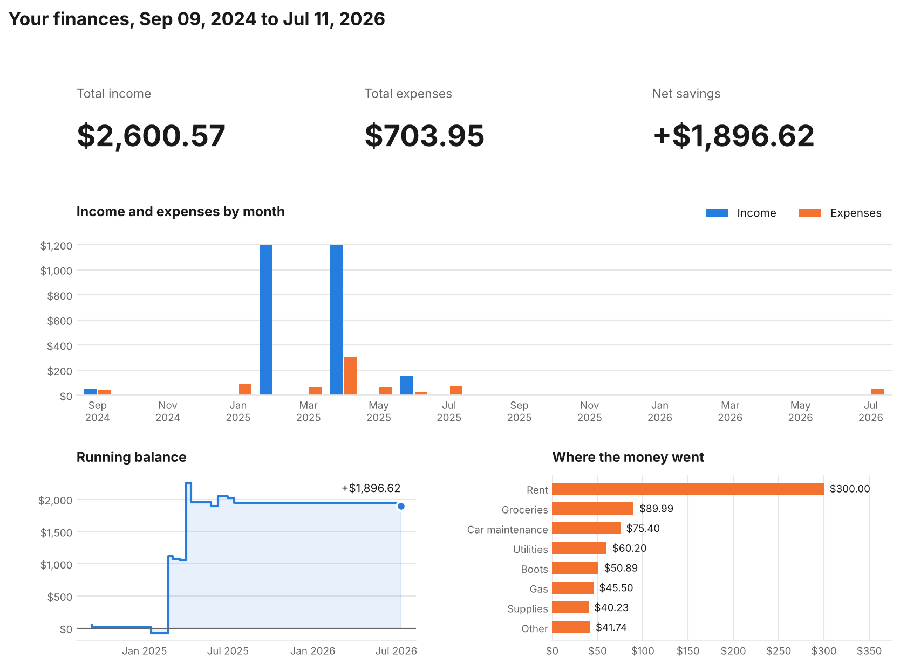

# Personal Finance Tracker

A command-line personal finance tracker built in Python. Log income and expenses to a CSV file, review any date range with a printed summary, and open a one-page dashboard showing where your money goes.



## Features

- **Add transactions**: record a date, amount, category (Income/Expense) and description
- **Input checking**: bad dates, amounts or categories are caught, and you're asked again
- **Date-range view**: list every transaction between two dates, with total income, expenses and net savings
- **Dashboard** with four views of the selected period:
  - Headline totals for income, expenses and net savings
  - Income vs. expenses for each month
  - A running balance showing how savings build up over time
  - The biggest expenses, grouped by description
- **CSV storage**: a plain, human-readable file you can open in Excel; no database needed

## Tech Stack

- Python 3
- [pandas](https://pandas.pydata.org/) for filtering and grouping transactions
- [matplotlib](https://matplotlib.org/) for the dashboard

## Project Structure

```
.
├── main.py           # Menu: add or view transactions
├── data_entry.py     # Asks for each field and re-asks until the answer is valid
├── storage.py        # Reads and writes finance_data.csv
├── charts.py         # Draws the dashboard
├── finance_data.csv  # Your transactions (sample data included)
└── requirements.txt
```

## Getting Started

### Prerequisites

- Python 3.9+

### Installation

```bash
git clone https://github.com/tmburbeck/personal-finance-tracker.git
cd personal-finance-tracker
pip install -r requirements.txt
```

### Usage

```bash
python main.py
```

You'll see a simple menu:

```
1. Add a new transaction
2. View transactions and summary
3. Exit
```

- **Option 1** walks you through entering a date, amount, category and description. Press Enter at the date prompt to use today's date.
- **Option 2** asks for a start and end date, prints the transactions and a summary, and offers to open the dashboard.
- **Option 3** exits the program.

Dates are entered as `dd-mm-yyyy`, e.g. `31-12-2025`.

## Possible Next Steps

- Spending categories beyond Income/Expense (rent, food, transport...) with a budget for each
- Move storage from CSV to SQLite for faster searching
- A simple web interface (Flask) on top of the same `storage.py`
- Export the dashboard and summary as a PDF report

## License

MIT
